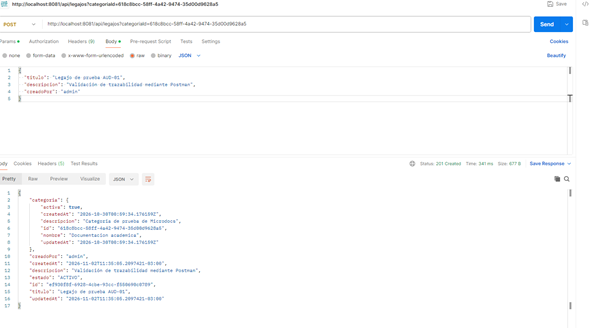
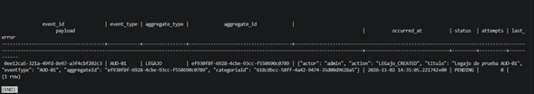

# Hito técnico: Creación de legajo y persistencia Outbox

## Objetivo
Validar la creación de un legajo y la persistencia de su evento de auditoría AUD-01 en la tabla Outbox.

## Implementación
- Endpoint: `POST /api/legajos`
- Puerto local: `8081`
- Evento: `AUD-01`
- Tipo de agregado: `LEGAJO`
- Tabla Outbox: `legajos.outbox_event`

## Validación
La creación fue probada mediante Postman y respondió `201 Created`.

Se verificó en PostgreSQL que el evento quedó persistido con estado `PENDING`, intentos `0` y un `aggregate_id` coincidente con el identificador del legajo creado.

Esta validación confirma la persistencia local del evento. La publicación a Event Grid y el almacenamiento en la auditoría central corresponden a etapas posteriores.

## Evidencias

### Creación del legajo mediante Postman

### Persistencia del evento en Outbox

